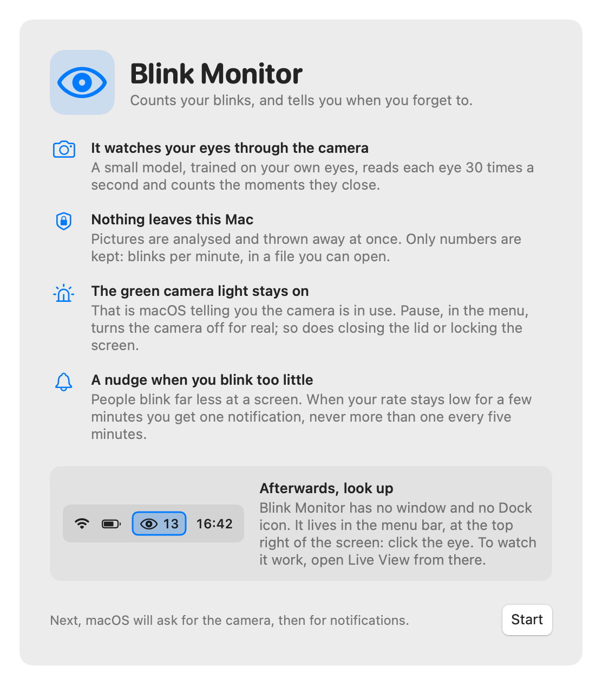
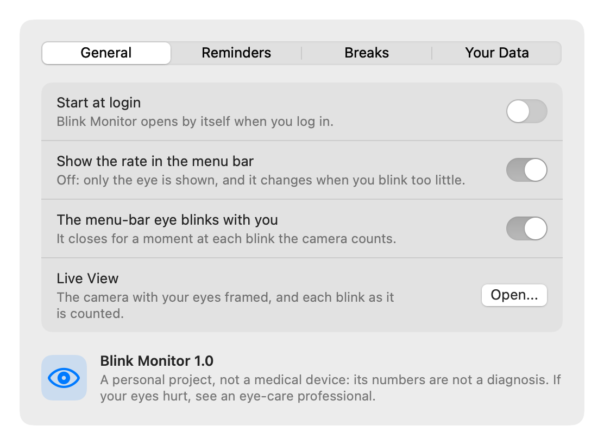
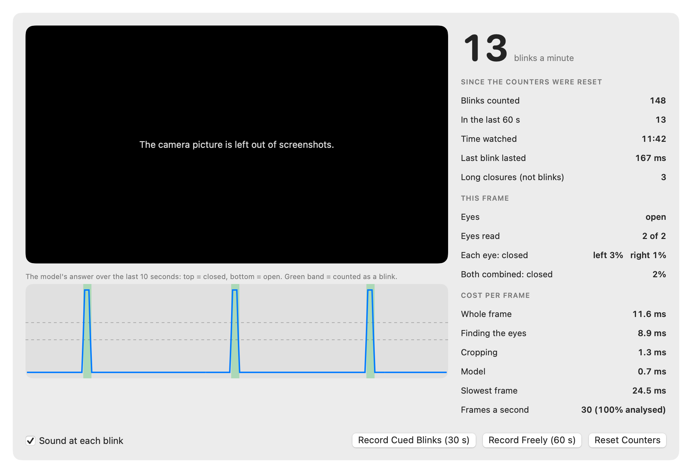
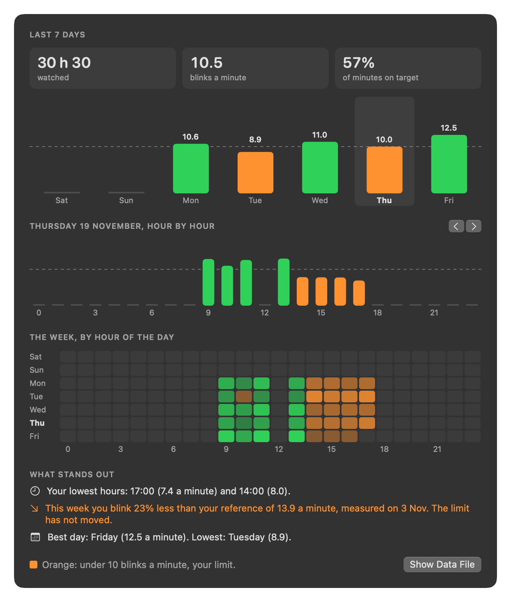
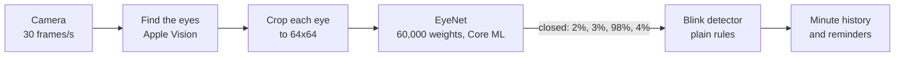
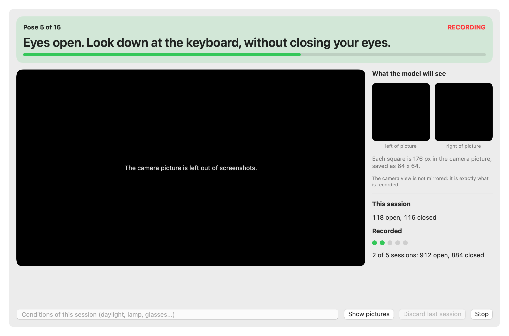

# Blink Monitor

[](https://github.com/MattDupp/blink-monitor/actions/workflows/ci.yml)

A macOS menu-bar app that counts your blinks through the webcam, with a small neural
network **you train on your own eyes**. Everything runs on your Mac: no picture is stored
or sent anywhere.

<p align="center">
  
  &nbsp;&nbsp;
  
</p>

<sub>Screenshots are rendered by the app itself with made-up data (`make snapshots`). A window that is never shown draws its switches grey: read a switch by the side its knob is on.</sub>

## Try it first

No camera, no model, nothing to record: the demo runs the whole app on made-up blinks.
It needs an Apple Silicon Mac, macOS 14 or later and Apple's Command Line Tools
(`xcode-select --install`), and builds in about a minute.

```bash
git clone https://github.com/MattDupp/blink-monitor.git && cd blink-monitor
```

```bash
make demo
```

An eye marked "demo" appears in the menu bar and its panel opens. Every window works, the
blink break counts, and the made-up eyes are counted by the same code that counts real ones.
It never opens the camera and keeps its settings and history apart from the real app's.
To use Blink Monitor on your own eyes, see [Train it on your own eyes](#train-it-on-your-own-eyes).

## Why

People blink much less when they look at a screen, and for someone with dry eyes that is
exactly when it hurts. I wanted to know when I stop blinking, and I wanted to learn how a
small vision model is built end to end: collecting data, training, measuring honestly,
and shipping it inside a real app.

## What it does

- Shows your **blinks per minute** in the menu bar, with no Dock icon and no window.
  The eye in the menu bar **blinks when you do**: the quickest proof that it sees you.
- **Live View** shows what the app sees: the camera with your eyes framed, the model's
  answer as a curve, and a sound at each blink it counts.
- Keeps a **minute-by-minute history** (numbers only): today, the last hour, any of the last
  seven days hour by hour, the week as a heat map, and a few sentences on what stands out.
- **Reminds you** when your rate stays low for three minutes; at most one reminder every
  five minutes, none for the time you were away. The banner has two buttons: start a blink
  break, or snooze for an hour.
- **Blink break**: ten slow, full blinks, counted by the camera, with a sound at each one
  because your eyes are closed.
- **A limit that fits you, and does not follow you down.** The app measures your usual rate
  once and sets the limit at 70% of it. See [the baseline](#a-baseline-that-does-not-follow-you-down).
- **Look-away nudges** (off by default): after 20 minutes at the screen, look at something
  far away for 20 seconds.
- **Pause** for 15 minutes, an hour, until tomorrow or until you resume. It switches the
  camera off for real and ends by itself; the camera also goes off when the screen sleeps
  or locks.

<p align="center">
  
  &nbsp;
  
  &nbsp;
  
</p>

<details>
<summary>More screens</summary>
<p align="center">
  
  &nbsp;
  
</p>
<p align="center">
  
</p>
<p align="center">
  
  &nbsp;
  
</p>
</details>

## How it works



1. **Find the eyes.** Apple's Vision framework places landmarks on the face. This part is not trained here.
2. **Crop.** Each eye becomes a 64x64 picture, so distance to the screen stops mattering.
3. **Classify.** A small convolutional network answers one question per eye: how sure is it that this eye is closed?
4. **Count.** A blink is a pattern in those answers: open, briefly closed, open again. A few rules turn the stream into blinks and reject look-downs and single-frame noise.

The same code cuts the eye pictures in the recorder and in the app, so the model is asked
about pictures made exactly like the ones it learned from.
[How it works](docs/HOW-IT-WORKS.md) goes through each step with figures.

<p align="center">
  
</p>

## A baseline that does not follow you down

People do not blink alike, so one limit for everybody is wrong for many. The obvious fix is
a personal baseline: learn your usual rate, warn when you fall well under it. It has a trap:
a baseline that keeps averaging your recent weeks goes down with you. Blink a little less
each month and it follows; a limit set at 70% of it follows too, and the app stops warning
about exactly the decline it is there to catch.

So the reference is built not to move by itself (`Sources/BlinkCore/History/Baseline.swift`):

- It is **measured once**: the median of your first three hours watched, over at least two days. Then it is kept.
- A decline is **reported, not absorbed**: "this week you blink 23% less than your reference", in the panel and in the History window.
- **Measuring again is your decision.** If the new value is lower, Settings says so, and what it does to the limit, before you confirm.
- The limit **never goes under a floor you set**, which covers a reference measured while you were already blinking too little.

A test feeds it four weeks of steady decline and checks that neither the reference nor the limit has moved.

<p align="center">
  
</p>

## Results

Measured on one person (me), on recordings made in one morning. Read them as "it works
for its author in his usual light", not as a general claim.

**Accuracy**

| What is measured | Result | How |
|---|---|---|
| Eye pictures answered right | 99.7% of 4,713 | each recording session judged by a model trained without it |
| Real blinks counted | 72 of 72 | 122 s of video with every blink marked by hand, each capture judged by a model that never saw it |
| False blinks | 1 in those 122 s | same |

The first version found 57 of those 72 blinks (79%). Getting to 72 took two changes that
the hand-marked blinks pointed to; [Lessons](docs/LESSONS.md) tells that story.

**Cost on a MacBook Pro (M5 Pro)**

| | First version | Now |
|---|---|---|
| Handing one eye picture to Core ML | 9.1 ms | 0.12 ms |
| Memory after running for a while | 591 MB after 11 min, 2.6 GB after 4 h (a leak) | 240 MB after one hour |
| Processor, one core, while watching you | about 60% | about 37% |
| Processor, nobody in front of the camera | about 60% | under 5% |

**One optimisation did not pay.** Finding the eyes (Apple Vision) is three quarters of a
frame's cost, so searching on every other frame, and reading the same squares in between,
should have nearly halved it. Measured by the app's own log: a frame went from about 14.5 ms
to 12.3 ms, 15% less. Each search now takes about 18 ms where it took 12. I have not found
out why yet, and 37% of a core is more than a background app should use; this is the next
thing to work on. The app logs its cost once a minute to
`~/Library/Application Support/BlinkMonitor/performance.csv`.

## Privacy

- The camera picture is analysed in memory and dropped. Nothing is uploaded; the app makes no network connection.
- What is kept: one line per minute (time watched, blinks) in `~/Library/Application Support/BlinkMonitor/history.csv`. Settings shows the file and can erase it.
- Pictures are written to disk only by the recorder and by the capture buttons of the Live View window, when you press them, to build your own training data.
- This repository contains **no recordings and no trained model**. Both are personal, and both are yours to make.
- Recordings are written to folders only your account can read.
- Both apps are signed with macOS's hardened runtime and ask for one thing, the camera, so another program cannot load its code into them to borrow that permission.

## Train it on your own eyes

You need an Apple Silicon Mac with macOS 14 or later, Apple's Command Line Tools
(`xcode-select --install`; full Xcode is not required) and [uv](https://docs.astral.sh/uv/).

`make doctor` checks all of that and says what is missing. Each command ends by naming the next one.

| Step | Command | What happens |
|---|---|---|
| 1. Record | `make recorder` | A voice guides you through 16 poses, eyes open and closed. Two minutes a session; the recorder counts them and tells you when you have the five it recommends. |
| 2. Train | `make train` | Trains the model (about a minute), reports its accuracy on sessions it never saw, converts it to Core ML and checks the conversion. |
| 3. Run | `make monitor` | Installs the menu-bar app in `~/Applications` and starts it. macOS asks for the camera. |

<p align="center">
  
</p>

**Make it better with your own blinks.** The recorder's pictures are eyes held open or
closed; a real blink is caught half-way and blurred. Once the app runs, open Live View,
press *Record Freely (60 s)* a few times while you work, then:

```bash
make improve
```

It labels the blink frames of those captures by itself, trains again and converts. On my
recordings this step took the count from 79% to 93% of real blinks
([Lessons](docs/LESSONS.md), numbers 2 and 4).

After training, `training/out/review_suspicious.png` shows the pictures the model
disagrees with. Many will be blinks you made during an "eyes open" pose. Delete them, run
`python3 scripts/sync_manifests.py`, and train again.
[Development](docs/DEVELOPMENT.md) describes every command and file format.

## Troubleshooting

| What you see | Why, and what to do |
|---|---|
| macOS asks for the camera again | The permission belongs to one build. A rebuilt app is a new app to macOS: allow it again. |
| "No camera" in the panel | The camera was refused. Press *Open Camera Settings* in the panel, allow Blink Monitor, and open it again. |
| "No picture" in the panel | The camera is on but sends nothing: the lid is closed, or the camera failed. Counting resumes by itself. |
| No eye in the menu bar | On a MacBook with many menu-bar items, the notch can hide it. Quit a few, or use a menu-bar manager. |
| No reminder ever shows | Settings > Reminders > *Send a Test Reminder*. If nothing appears, allow notifications for Blink Monitor in System Settings. |
| A banner with a blank icon after reinstalling | Notification Centre kept the old one. Run `killall NotificationCenter`; macOS restarts it. |
| The linker prints "search path ... not found" | Harmless: two folders that only exist inside Xcode. `make` hides them. |

To remove the app: `make uninstall`. It keeps your history, your recordings and your model, and says where they are.

## Project layout

```
Sources/BlinkCore        camera, eye finding and cropping, model, counting rules, history, file formats
Sources/BlinkUI          the SwiftUI views both apps share, and the screenshot renderer
Sources/BlinkRecorder    the app that records labelled eye pictures
Sources/BlinkMonitor     the menu-bar app, and its demo
Tests/BlinkCoreTests     84 tests of the rules (Swift Testing)
Tests/BlinkMonitorTests  12 tests of the app itself: its model, its clock, the demo
training/                PyTorch training, Core ML conversion, labelling and evaluation tools, 23 tests
scripts/                 app bundling, prerequisite check, icon drawing, manifest repair
docs/                   how it works, lessons, development notes
```

## Limits and roadmap

- **One person, one morning.** The model has only seen its author, in daylight. Other light is untested.
- **Processor use.** About 37% of one core while it watches you (see Results).
- **Screen breaks are inferred.** The camera knows whether a face is in view, not where the eyes look.
- **Glasses.** A screen reflection covering the iris can read as a closed eye.
- **Looking down** at the keyboard looks like closed eyes from the camera's angle. A closure longer than 0.6 s is not counted as a blink, which covers most of it.
- **Incomplete blinks** (the lid comes down part of the way) matter for dry eyes and are not measured yet.
- **30 frames a second** is all the built-in camera gives. A very fast blink is closed on a single frame.

## Not a medical device

Blink Monitor is a personal project and a learning exercise. Its numbers are not a
diagnosis, and its limits (10 blinks a minute to start with, then 70% of your own usual
rate) are starting points, not medical ones. If your eyes hurt, see an eye-care professional.

## Licence

[MIT](LICENSE).
