# Blink Monitor

[](https://github.com/MattDupp/blink-monitor/actions/workflows/ci.yml)

A macOS menu-bar app that counts your blinks through the webcam, with a small neural
network **it trains on your own eyes**: two recordings of two minutes, a few seconds of
training, and a test where you blink and watch it count. Everything happens on your Mac,
and nothing is sent anywhere.

<p align="center">
  
  &nbsp;&nbsp;
  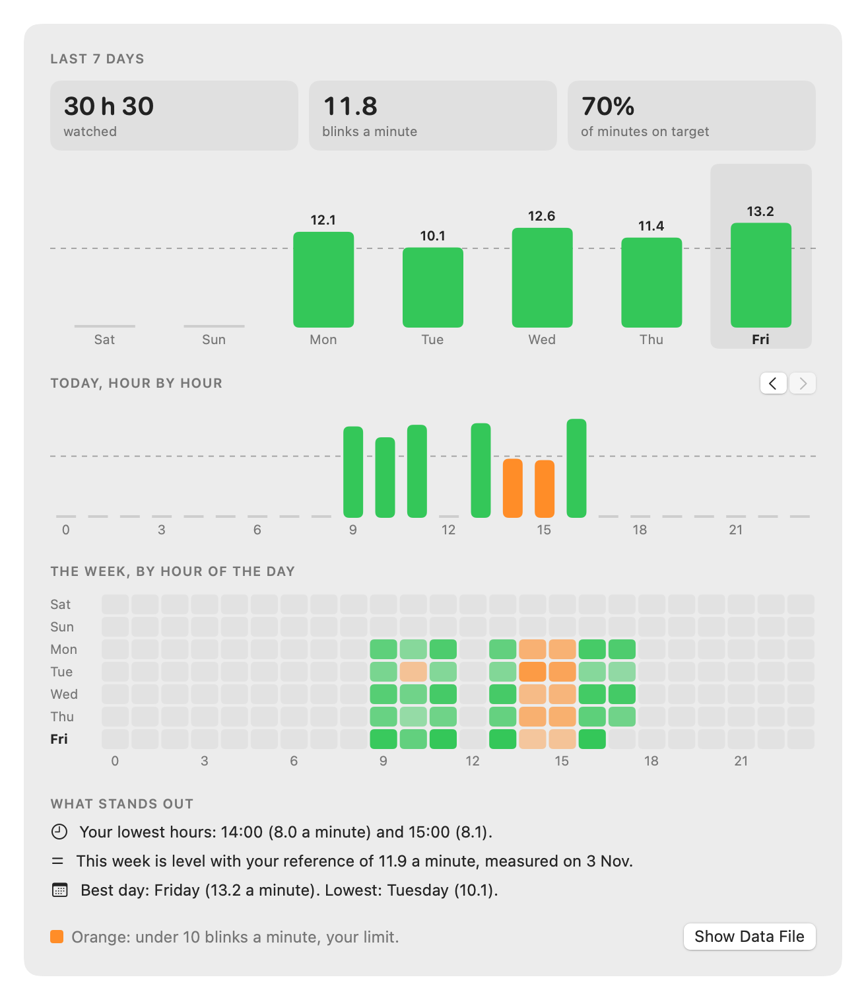
</p>

<sub>Screenshots are rendered by the app itself with made-up data.</sub>

## Try it

**[Download the disk image](https://github.com/MattDupp/blink-monitor/releases/latest/download/BlinkMonitor.dmg)**
(`BlinkMonitor.dmg`, a few MB). It needs a Mac with an Apple chip and macOS 14 or later.
No terminal.

1. Open the file. A window shows Blink Monitor next to a shortcut to your Applications folder.
2. Drag Blink Monitor onto Applications. Do this before you open it.
3. Open Blink Monitor from Applications. The first time, macOS stops it: see
   [If macOS stops it](#if-macos-stops-it).
4. An eye appears in the menu bar, at the top right of the screen, and the setup window opens.
   While the setup is open, Blink Monitor also has an icon in the Dock.

**The app comes without a model, and makes one with you.** It counts blinks with a model
trained on one person's eyes. That model is personal, so none comes with the app. The
first time, the setup checks the camera, records your eyes twice, trains the model on your
Mac and tests it: about eight minutes, in one window. See
[The setup, step by step](#the-setup-step-by-step). To look around first, the setup's
first page offers a demo on made-up blinks, with the camera off.

### If macOS stops it

The first time you open it, macOS shows a window titled ***"Blink Monitor" Not Opened***. It
says that Apple could not verify the app, and it has two buttons: **Done** and
**Move to Trash**.

**Press Done. Do not press Move to Trash.** Then, on macOS 15 and later:

1. Open **System Settings > Privacy & Security**.
2. Scroll down to *Security*. A line says that Blink Monitor was blocked.
3. Press **Open Anyway** beside that line. The button stays for about an hour after the
   refusal. If it is gone, open Blink Monitor once more and come back.
4. Press **Open Anyway** again in the window that follows, then give your password or
   Touch ID.

On macOS 14 the window has no such button. Hold Control and click Blink Monitor in
Applications, choose **Open**, then **Open** again.

You do this once per version. After an update, macOS asks again.

**Why macOS does this.** macOS only opens a downloaded app without a question when its
developer pays Apple for a yearly account and has Apple scan the app. This one is free and
Apple has not scanned it. All of its code is in this repository.

### Update it, remove it

- **Update:** quit Blink Monitor (click the eye, then *Quit*). Open the new disk image, drag
  again, and choose *Replace*.
- **Remove:** quit it and drag it from Applications to the Trash. Your history, and the
  recordings and model the app made, stay in `~/Library/Application Support/BlinkMonitor`.
  Settings > Your Model deletes the recordings and the model.

### Build the demo yourself

No camera, nothing to record: the demo runs the whole app on made-up blinks. If you have
Apple's Command Line Tools (`xcode-select --install`), it builds in about a minute. macOS
asks nothing then: an app built on your own Mac was not downloaded.

```bash
git clone https://github.com/MattDupp/blink-monitor.git && cd blink-monitor
```

```bash
make demo
```

An eye marked "demo" appears in the menu bar and its panel opens. Every window works, the
blink break counts, and the made-up eyes are counted by the same code that counts real ones.
After a minute a look-away break starts: the made-up person looks away, and a sound says
when the 20 seconds are over. The third break is a long one, of one minute.
It never opens the camera and keeps its settings and history apart from the real app's.
*See the Setup*, in its panel, goes through the setup on painted eyes: they are recorded,
a model is really trained on them, and it is really tested.
To use Blink Monitor on your own eyes, [download it](#try-it), or
[build it yourself](#build-it-yourself).

## Why

People blink much less when they look at a screen, and for someone with dry eyes that is
exactly when it hurts. I wanted to know when I stop blinking, and I wanted to learn how a
small vision model is built end to end: collecting data, training, measuring honestly,
and shipping it inside a real app.

## What it does

- **Sets itself up on your eyes.** The first time, it checks the camera, records your eyes
  twice, trains its model on this Mac and tests it. About eight minutes, in one window.
- Shows your **blinks a minute** in the menu bar, with no Dock icon and no window.
  The eye in the menu bar **blinks when you do**: the quickest proof that it sees you.
- **Live View** shows what the app sees: the camera with your eyes framed, the model's
  answer as a curve, and a sound at each blink it counts.
- Keeps a **minute-by-minute history** (numbers only): today, the last hour, any of the last
  seven days hour by hour, the week as a heat map, and a few sentences on what stands out.
- **Reminds you** when your rate stays low for three minutes, and never for the time you
  were away. A reminder left unanswered backs off: the next comes after 5, 15, 30, then 60
  minutes, and only the first two make a sound. A blink break answers it: none for 20
  minutes. The banner has two buttons: start a blink break, or quiet for an hour.
  If your usual rate turns out to be under the starting limit of 10, the panel says so
  once and offers to follow your own rate.
- **Blink break**: ten slow, full blinks, counted by the camera, with a sound at each one
  because your eyes are closed.
- **A limit that fits you, and does not follow you down.** The app measures your usual rate
  once and sets the limit at 70% of it. See [your usual rate](#a-usual-rate-that-does-not-follow-you-down).
- **Shows what studies report**, next to your own rate and limit: how often healthy adults
  blink at a screen, at rest and in conversation, with the papers one click away.
  See [what studies say](#what-studies-say-about-blink-rate).
- **Look-away breaks** (off by default), with every number yours to set: the time between
  breaks, the length of a break, and a long break away from the screen after every few
  short ones. It starts from the classic 20-20-20. A break starts by itself and a sound
  says when it is over, so there is nothing to watch. Each of the two sounds, at the start
  and at the end, has a switch. The panel counts the day's breaks,
  and says which ones the camera saw you take away from the screen.
- **Routines** (off by default): a reminder to put in eye drops at the times you set, for
  example 08:00, 13:00 and 17:00. It is silent, waits until you are at the screen, and has
  two buttons: Done, or Later. The panel shows today's times and which are done. The app
  reminds you of a routine you chose; it gives no advice on what to use or how often.
- **Routines of your own**: add a reminder in Settings, name it, and choose how it comes:
  at times of day, a number of times a week, or every so many minutes at the screen, such
  as drinking water every 60 minutes. The minutes are counted while you are at the screen,
  not on the clock. Several routines stay gentle: banners come one at a time, at least 5
  minutes apart and at most 4 in an hour, and Quiet in the panel silences them, with every other reminder,
  for 30 minutes, an hour or until tomorrow.
- **A routine counted by the week** (off by default): a heated eye mask three times a
  week, for example. It asks on the days you prefer until the week's count is reached, and
  asks the next day when one is missed. "Done" in the panel counts at any time, and the
  panel shows the week, such as "2 of 3 this week". Its timer pauses the camera while your
  eyes are covered, plays a sound at the end and marks it done. You set the timer's length
  from the instructions of what you use; the app gives no advice on it.
- **Pause** for 15 minutes, an hour, until tomorrow or until you resume. It switches the
  camera off for real and ends by itself; the camera also goes off when the screen sleeps
  or locks.
- **Quiet** for 30 minutes, an hour or until tomorrow, from the panel. No reminder, no
  look-away break and no sound, of any kind. Blinks are still counted, and the choice
  survives a restart of the app.
- **Reminders that know each other.** Nothing arrives during a look-away break, a blink
  break, a routine's timer or the setup. Two banners are at least two minutes apart.
  When two would come together, a break goes first.

<p align="center">
  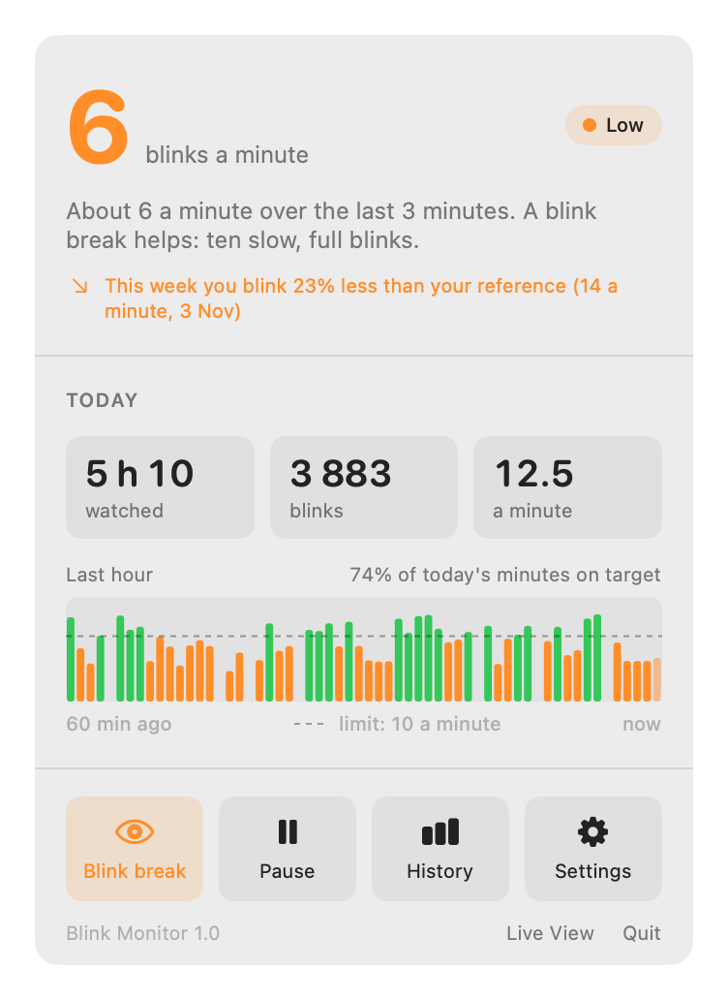
  &nbsp;
  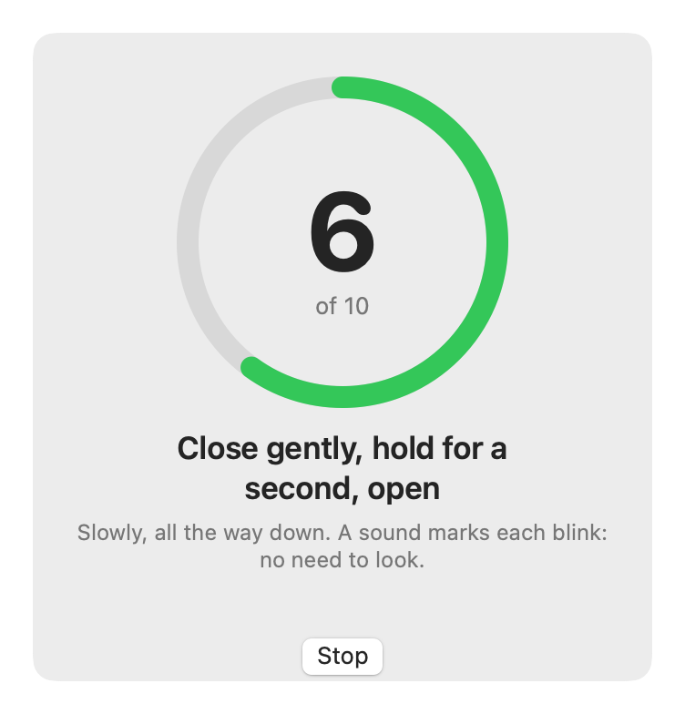
  &nbsp;
  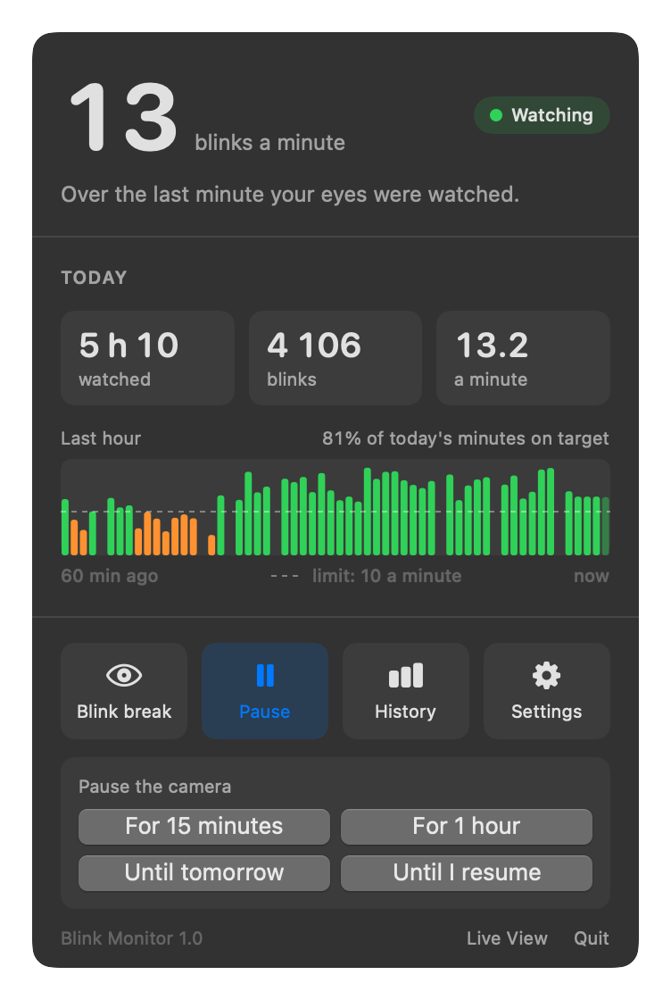
</p>

<details>
<summary>More screens</summary>
<p align="center">
  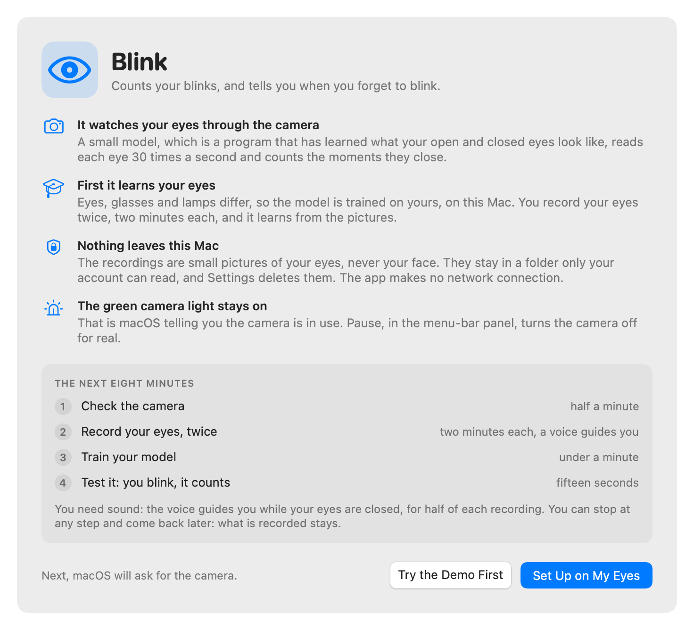
  &nbsp;
  
</p>
<p align="center">
  
</p>
<p align="center">
  
  &nbsp;
  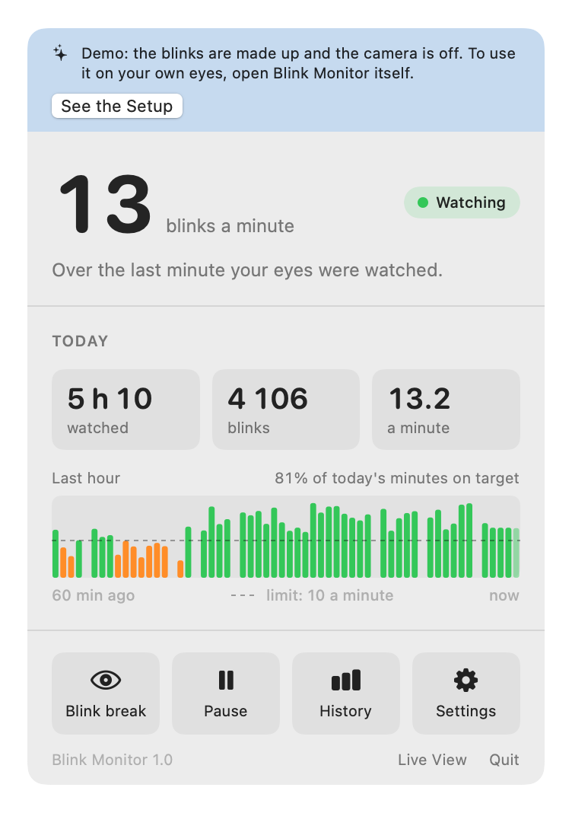
</p>
<p align="center">
  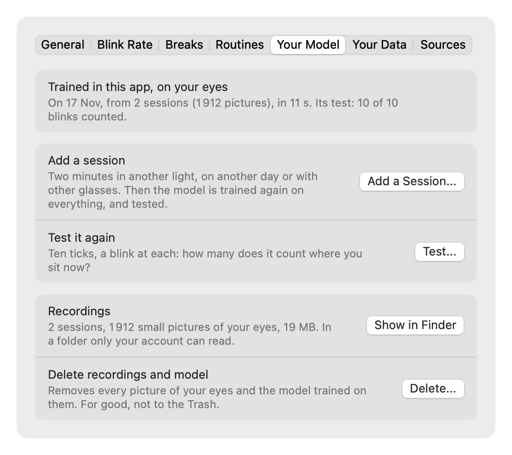
  &nbsp;
  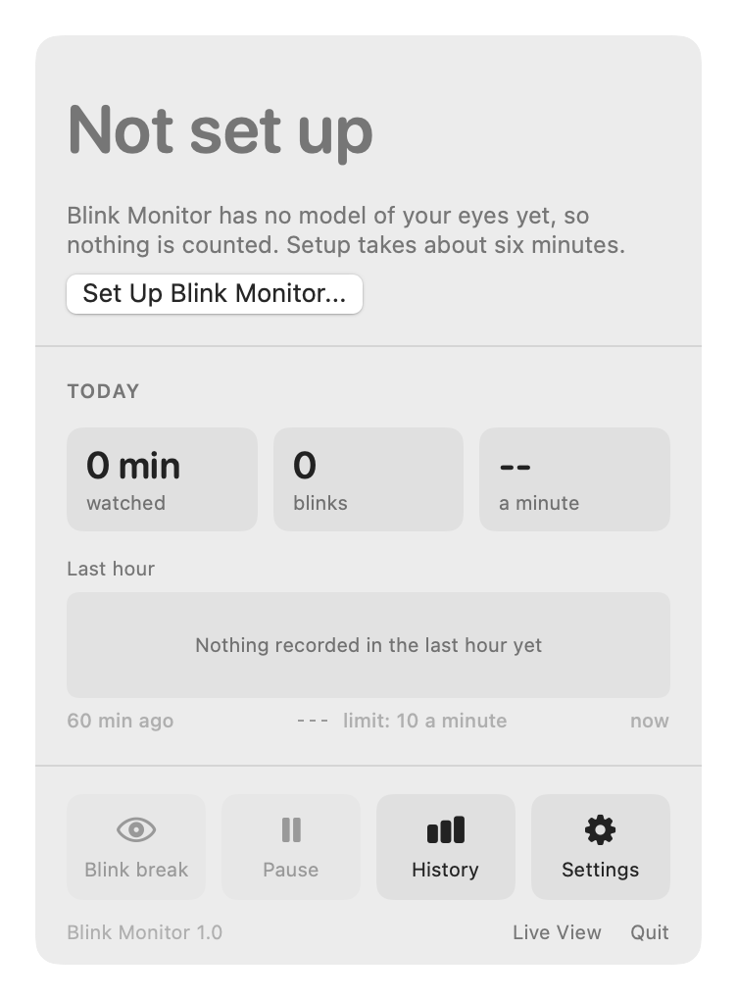
</p>
</details>

## How it works

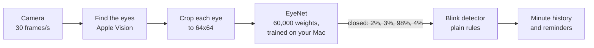

1. **Find the eyes.** Apple's Vision framework places landmarks on the face. This part is not trained here.
2. **Crop.** Each eye becomes a 64x64 picture, so distance to the screen stops mattering.
3. **Classify.** A small convolutional network answers one question per eye: how sure is it that this eye is closed?
4. **Count.** A blink is a pattern in those answers: open, briefly closed, open again. A few rules turn the stream into blinks and reject look-downs and single-frame noise.

The same code cuts the eye pictures when they are recorded and when they are read, so the
model is asked about pictures made exactly like the ones it learned from.
[How it works](docs/HOW-IT-WORKS.md) goes through each step with figures.

<p align="center">
  
</p>

## A usual rate that does not follow you down

People do not blink alike, so one limit for everybody is wrong for many. The obvious fix is
a personal reference: learn your usual rate, warn when you fall well under it. It has a trap:
a usual rate that keeps averaging your recent weeks goes down with you. Blink a little less
each month and it follows; a limit set at 70% of it follows too, and the app stops warning
about exactly the decline it is there to catch.

So the usual rate is built not to move by itself (`Sources/BlinkCore/History/Baseline.swift`):

- It is **measured once**: the median of your first three hours watched, over at least two days. Then it is kept.
- A decline is **reported, not absorbed**: "this week you blink 23% less than your usual rate", in the panel and in the History window.
- **Measuring again is your decision.** If the new value is lower, Settings says so, and what it does to the limit, before you confirm.
- The limit **never goes under the lowest limit you set**, which covers a usual rate measured while you were already blinking too little.

A test feeds it four weeks of steady decline and checks that neither the usual rate nor the limit has moved.

<p align="center">
  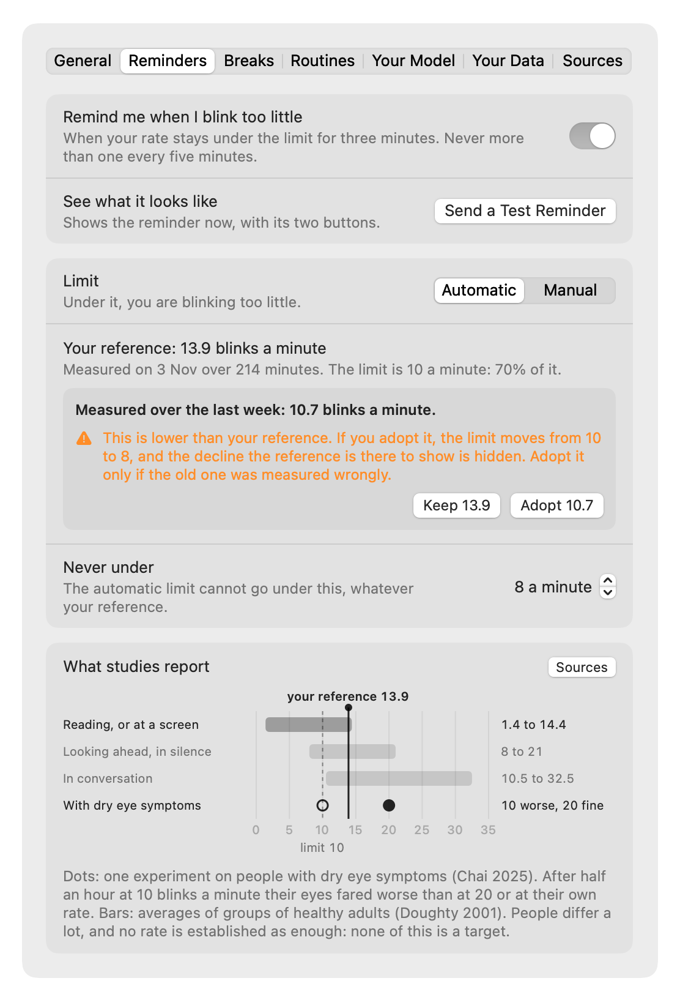
</p>

## What studies say about blink rate

Before putting a "healthy range" in the app I read the studies. There is no ideal blink
rate in them. One experiment and one review carry most of what the app says.

**The experiment** (Chai 2025) is the only study that changed the blink rate and measured
the eyes afterwards. In 45 young adults with dry eye symptoms, half an hour at 10 blinks a
minute left the tear film less stable, the eyes redder and the symptoms worse than half an
hour at 20 a minute or at their own rate. It is the app's main source: the limit starts at
that 10. It is also small, tested two rates only, away from a screen, and has not been
repeated.

**The review** (Doughty 2001, 75 years of studies) gives what is typical, and it depends
on what you are doing:

| What the person is doing | Blinks a minute, averages of study groups |
|---|---|
| Reading, or working at a screen | 1.4 to 14.4 |
| Looking straight ahead, in silence | 8.0 to 21.0 |
| In conversation | 10.5 to 32.5 |

Three more things the studies say shaped the app:

- **No rate is established as enough.** So the app calls the ranges typical, never ideal,
  and they never move your limit: it shows them next to it.
- **Complete blinks count for more than the rate.** In a study of 453 people the share of
  incomplete blinks predicted dry eye disease, and the rate was linked to nothing measured
  on the eye surface (Wang 2025). Blink Monitor counts complete blinks and does not
  measure incomplete ones yet.
- **Healthy people at a screen average about 5 complete blinks a minute** (Freudenthaler
  2003), from 0.4 to 18.9 from one person to the next. A limit of 10 calls many of them
  low. So Settings says so when the limit sits above your own usual rate, and the floor
  can be lowered as far as 1.

[What is a healthy blink rate?](docs/BLINK-RATE.md) has the answer in full, a table of the
studies, what they disagree on and the 56 sources. Of those, 16 were read in full, 39 as
abstracts and 1 only through a review, and the page says which.

<p align="center">
  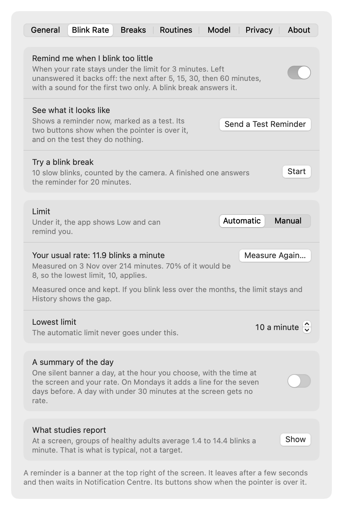
</p>

## Results

Measured on one person (me), on recordings made in one morning. Read them as "it works
for its author in his usual light", not as a general claim.

**Accuracy**

| What is measured | Result | How |
|---|---|---|
| Eye pictures answered right | 99.7% of 4,713 | each recording session judged by a model trained without it |
| Real blinks counted | 72 of 72 | 122 s of video with every blink marked by hand, each capture judged by a model that never saw it |
| False blinks | 1 in those 122 s | same |

The first version found 57 of those 72 blinks (79%). Getting to 72 took two changes that
the hand-marked blinks pointed to; [Lessons](docs/LESSONS.md) tells that story.

**The model the app trains itself**

The figures above are from the Python route, which was there first and is now the lab.
The app has its own trainer, written in Swift on Apple's MPSGraph, so that nobody needs
Python to use it. `make compare` runs both on the same pictures and the same splits and
scores them with the same code:

| | Python route | The app's trainer |
|---|---|---|
| Eye pictures answered right, session never seen (of 4,713) | 99.68% (15 wrong) | 99.58% (20 wrong) |
| Real blinks found, over 13 trainings with different random starts (13 x 72) | 936 of 936 | 936 of 936 |
| False blinks in those 13 x 122 s | 6 | 7 |
| One training on about 3,800 pictures | 11 s | 17 s |

Those trainings include frames of real blinks (see "Make it better" below). A new user
has none: only the sessions of the setup. So the same count again, trained on recorded
sessions alone, by number of sessions and over every choice of them:

| Sessions | Blinks found of 72, the app's trainer | Python route |
|---|---|---|
| 1 | 55 to 70 (63 on average) | 43 to 71 (58) |
| 2 | 60 to 72 (69) | 58 to 72 (68) |
| 3 | 67 to 71 (70) | 69 to 72 (70) |
| 4 | 71 | 70 |

One session is a gamble. Two are close to four on average, though the worst pair still
missed 12 blinks. That is why the setup asks for two, offers a third, and ends with a
test instead of trusting these numbers: they are one person's, and the blinks were filmed
minutes after the sessions, in the same light. Every seed of both trainers met the bar
this project set itself: all 72 blinks found, at most 1 false.

Two other ways of training on the Mac were tried first and measured the same way. Core
ML's own on-device training cannot train this network's batch normalisation: it found 211
of 216 blinks where the two above found all 216. Create ML's image classifier counted
well (71 of 72) but takes 2.8 ms to read one eye where this model takes 0.1 to 0.24 ms.
Their code is in the history of this repository (commit `e2cb8a9`).

**Cost on a MacBook Pro (M5 Pro)**

| | First version | Now |
|---|---|---|
| Handing one eye picture to Core ML | 9.1 ms | 0.12 ms |
| Memory after running for a while | 591 MB after 11 min, 2.6 GB after 4 h (a leak) | 240 MB after one hour |
| Processor, one core, while watching you | about 60% | about 32% |
| Processor, nobody in front of the camera | about 60% | under 5% |

A model trained in the app is run by the network written out in Swift: 0.24 ms per eye
picture, against 0.10 ms for the Core ML model of the Python route (908 real pictures,
one at a time). Inside the app the gap is wider: its log gave 1.9 ms a frame for the model
with the first model trained in the app, against 0.8 ms with the Core ML one, while the
whole frame stayed at 11 ms. That is one minute of log so far, and the Swift network has
not been tuned.

**One optimisation did not pay, the next one did.** Finding the eyes (Apple Vision) is
most of a frame's cost, so searching on every other frame, and reading the same squares in
between, should have nearly halved it. Measured by the app's own log: a frame went from
about 14.5 ms to 12.3 ms, 15% less. Each search took about 18 ms where it took 12.

A profile showed where a search goes, and that one part can be skipped: finding the face.
Vision accepts the box where the face was and only places the landmarks in it. The face is
now found twice a second instead of fifteen times. The same build, switched between the
two ways six times, three and a half minutes each:

| | Face found at every search | Face found twice a second |
|---|---|---|
| Finding the eyes, per frame | 10.7 ms | 5.2 ms |
| Whole frame | 14.7 ms | 9.4 ms |
| Processor, one core | 39% | 32% |

Does it still count the same blinks? Three recordings that keep the whole camera picture
(121 s, 80 blinks marked, with the head turning and leaving the picture on purpose) were
run through both ways. Each finds 72 of the 80. Blink by blink, the new way counts the 76
blinks the old one counts, and one more that is a real, marked blink. Two cautions: those
80 blinks were marked from the eye pictures by Claude, the AI assistant this app is built
with, not by me; and the setting was chosen on the recordings it is reported on.

32% of a core is still more than a background app should use. Cutting the eye pictures out
of the frame is now a third of a frame's cost, and the next thing to work on.
[Lessons](docs/LESSONS.md), number 5, has the whole story. The app logs its cost once a
minute to `~/Library/Application Support/BlinkMonitor/performance.csv`.

## Privacy

- Nothing is uploaded: the app makes no network connection. (The Sources tab opens a paper in your browser when you press its button.)
- While it counts, each camera picture is read and discarded at once.
- **What the setup keeps:** the small pictures of your eyes it recorded (64 x 64 pixels each, never your face, about 10 MB a session) and the model trained on them, in `~/Library/Application Support/BlinkMonitor/`, in folders only your account can read. Settings > Your Model shows them and deletes them, for good.
- **What counting keeps:** one line per minute (seconds counted, blinks) in `history.csv`, in the same folder. Settings shows the file and can erase it.
- With a routine switched on, one line each time a reminder is shown, done, put off or left, or a timer is started, in `routines.csv` in the same folder. A line names its routine by an id, never by the name you typed. Deleting a routine leaves its lines there: the file is only ever added to.
- Other pictures are written only by the two record buttons of the Live View window. The app you download does not show them: they appear when the app is started with a folder for captures, which `make monitor` does. A capture keeps two small pictures of your eyes per frame. Captures an earlier version saved among the app's own files are listed in Settings > Your Data, and Settings > Your Model deletes them with the recordings. It keeps the whole camera picture only if you started the app with `make monitor WHOLE_FRAMES=1`, a mode for testing changes to the eye finding; the Live View window says so for as long as it is on.
- This repository contains **no recordings and no trained model**. Both are personal, and both are yours to make.
- The disk image contains no model either. `make dmg` checks the app before packing it and the image afterwards, and refuses to build one that holds a model.
- The app is signed with macOS's hardened runtime and asks for one thing, the camera, so another program cannot load its code into it to borrow that permission.

## The setup, step by step

The first time it is opened, the app has no model, so it opens its setup. This is the same
whether you downloaded the app or built it. Every page says what is happening, how long it
takes and why.

| Step | What happens | How long |
|---|---|---|
| Camera | You see the camera with a square on each eye, and three checks: a face in view, eyes large enough, enough light. macOS asks for the camera here. | half a minute |
| Record | A voice asks for 16 poses, eyes open and closed, three seconds each. Then once more in another light. Every picture is saved with the pose you were asked for: that is how the model gets the right answer. If the camera loses your face during a pose, the voice says so and asks for that pose once more. The display stays awake meanwhile. | two minutes, twice |
| Train | The model is trained on this Mac. The window shows the passes, the time left as measured on your Mac, and your own pictures as the model is shown them. | seconds: 22 for four sessions on an M5 Pro, about half for two |
| Test | Ten ticks, and you blink at each. The ring fills with every blink the model counts, and the eye in the menu bar blinks with you. | fifteen seconds |

<p align="center">
  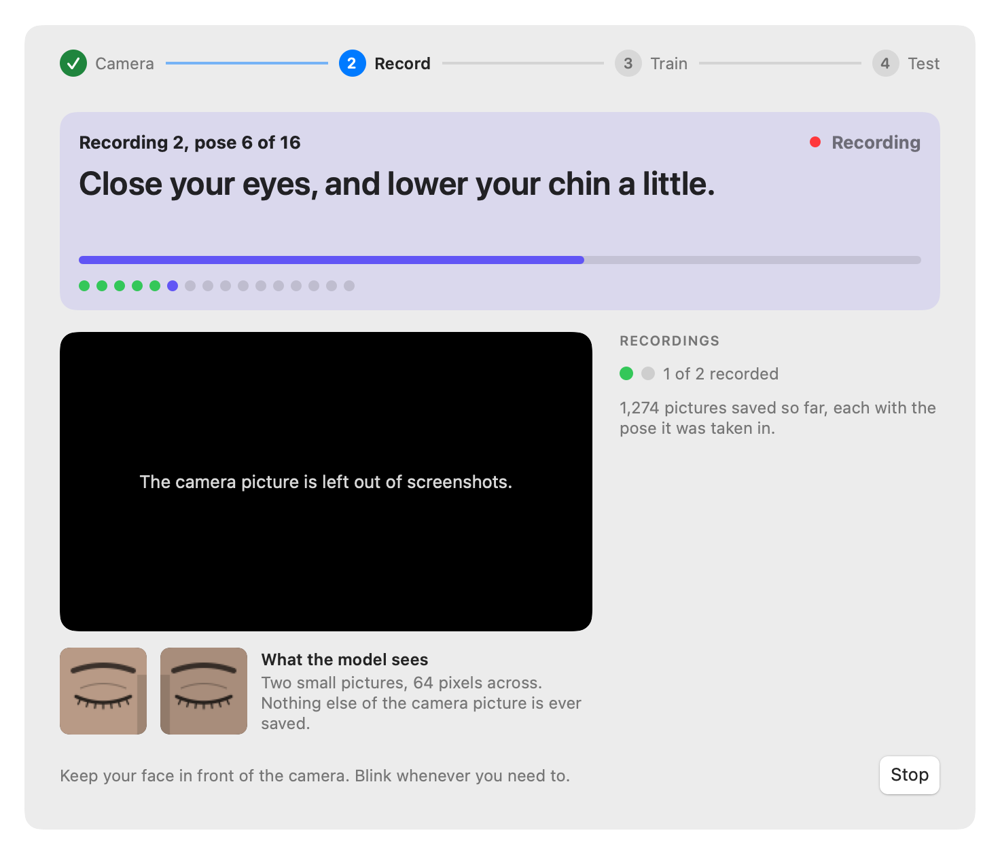
  &nbsp;
  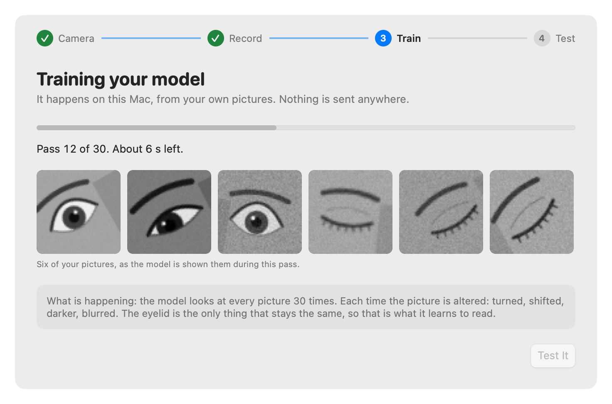
</p>
<p align="center">
  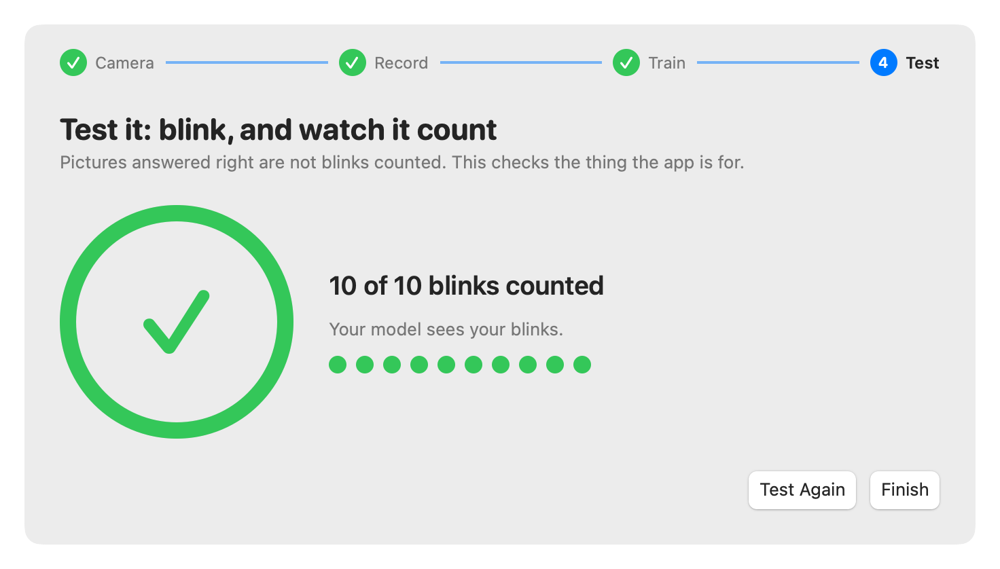
</p>

If the test counts 8 blinks or more, the app starts counting with the model at once. If it
counts fewer, it says how many and offers one more session where you sit now, the test
again, or the model as it is. You can close the window at any step: what was finished is
on disk, and the menu-bar panel offers to continue.

**Later.** Settings > Your Model adds a session (another light, another day, other
glasses) and trains again on everything, takes the test again, or deletes the recordings
and the model.

## Build it yourself

Nobody needs this section to use the app: the [disk image](#try-it) is the whole app. It is
for reading the code, changing it, or measuring the model.

You need an Apple Silicon Mac with macOS 14 or later and Apple's Command Line Tools
(`xcode-select --install`; full Xcode is not required). `make doctor` checks that.

```bash
make monitor
```

This builds the app, installs it in `~/Applications` and starts it. It has no model yet,
so it opens the setup described above.

If you also installed Blink Monitor from the disk image, quit that copy and move it to the
Trash first. macOS should know one copy only. `make monitor` checks, and tells you if the
other copy is still there.

The screenshots in this page come from `make snapshots`. A window that is never shown draws
its switches grey: read a switch by the side its knob is on.

### The Python route

The same training exists in Python (`training/`). It is where the model was first built,
where it is taken apart and measured, and the reference the app's trainer is held to. It
needs [uv](https://docs.astral.sh/uv/).

| Command | What happens |
|---|---|
| `make recorder` | Opens the app's setup with its sessions saved in `data/raw`, where the Python tools look. |
| `make train` | Trains in Python (about a minute), reports accuracy on sessions it never saw, converts to Core ML and checks the conversion. |
| `make monitor` | Builds the Core ML model into the app. |
| `make evaluate` | Counts the blinks of your hand-marked captures with models that never saw them. |
| `make compare` | Measures the app's own trainer against the Python one (the tables under Results). 29 minutes of training for 13 seeds; run it alone. |

The app uses, in this order: a model named at launch (`--model=`), the model trained in
the app, the model built in by `make monitor`. Settings > Your Model says which.

**Make it better with your own blinks.** The recorded pictures are eyes held open or
closed; a real blink is caught half-way and blurred. Once the app runs (started by
`make monitor`, which shows Live View's record buttons), open Live View,
press *Record Freely (60 s)* a few times while you work, then:

```bash
make improve
```

It labels the blink frames of those captures by itself, trains again and converts. On my
recordings this step took the count from 79% to 93% of real blinks
([Lessons](docs/LESSONS.md), numbers 2 and 4). It belongs to the Python route for now: the
app's own trainer learns from sessions only.

After training, `training/out/review_suspicious.png` shows the pictures the model
disagrees with. Many will be blinks you made during an "eyes open" pose. Delete them, run
`python3 scripts/sync_manifests.py`, and train again.
[Development](docs/DEVELOPMENT.md) describes every command and file format.

## Troubleshooting

| What you see | Why, and what to do |
|---|---|
| "Setup" in the panel, and "!" in the menu bar | The app has no model of your eyes yet. *Set Up Blink Monitor* (or *Continue Setup*) in the panel opens the window where you left it. |
| "No face found" in the setup | The Mac's own camera has to face you: the lid open, you in front of it. |
| "That session holds 58% of what it should" | Your face left the picture during some poses. The session is not kept: record it again. |
| "The training stopped" | Press *Try Again*. Your recordings are untouched and no half-made model is installed. If it stops a second time, the window shows what the trainer said. |
| The test counts fewer than 8 of 10 | Record one more session where you sit now: the model then learns from eyes in that light. |
| *"Blink Monitor" Not Opened* | macOS stops a downloaded app that Apple has not scanned. See [If macOS stops it](#if-macos-stops-it). |
| The panel says "Running from the disk image" | You opened the app inside the image's window. Quit it, drag it onto Applications, and open it from there. |
| Opening the app only opens its panel | It was already running. It has no window: the panel under the eye is the app. |
| `make monitor` says the app is already installed | A copy from the disk image is in Applications. Quit it and move it to the Trash, then run `make monitor` again. |
| macOS asks for the camera again | The permission belongs to one build. A rebuilt app is a new app to macOS: allow it again. |
| "No camera" in the panel | The camera was refused. Press *Open Camera Settings* in the panel, allow Blink Monitor, and open it again. |
| "No picture" in the panel | The camera is on but sends nothing: the lid is closed, or the camera failed. Counting resumes by itself. |
| No eye in the menu bar | On a MacBook with many menu-bar items, the notch can hide it. Quit a few, or use a menu-bar manager. |
| No reminder ever shows | Settings > Blink Rate > *Send a Test Reminder*. If nothing appears, allow notifications for Blink Monitor in System Settings. |
| A banner with a blank icon after reinstalling | Notification Centre kept the old one. Run `killall NotificationCenter`; macOS restarts it. |
| The linker prints "search path ... not found" | Harmless: two folders that only exist inside Xcode. `make` hides them. |

To remove the app: `make uninstall`. It removes every installed copy, the one from the disk image included. It keeps your history, your recordings and your model, and says where they are. Settings > Your Model deletes the recordings and the model.

## Project layout

```
Sources/BlinkCore        camera, eye finding and cropping, recording, training, the model, counting rules, history
Sources/BlinkUI          the SwiftUI views and the voice that are not tied to one window, and the screenshot renderer
Sources/BlinkMonitor     the menu-bar app: its setup, its windows, and its demo
Sources/BlinkTrain       the tool that runs the app's trainer on the comparison's trainings
Sources/BlinkReplay      the tool that replays recorded frames through the eye finding, and counts
Tests/BlinkCoreTests     225 tests of the rules and of the trainer (Swift Testing)
Tests/BlinkMonitorTests  100 tests of the app itself: its model, its setup, its choices, its words, its clock, its breaks, its routines, the demo, where it is installed
training/                PyTorch training, Core ML conversion, labelling, evaluation and comparison tools, 27 tests
scripts/                 app bundling, the installer's disk image, prerequisite check, icon drawing, manifest repair
docs/                    how it works, the research on blink rates, lessons, development notes
```

## Limits and roadmap

- **One person, one morning.** The model has only seen its author, in daylight. Other light is untested.
- **Apple has not scanned the download.** Scanning needs a paid developer account. Until then macOS stops the first opening.
- **The setup has been through its tests and one real run.** Its pages, its failures and its whole run on painted eyes are tested. Its author went through it once with a camera: two sessions, a training of 9 seconds, 9 of 10 blinks in the test, under seven minutes from launch to counting. Nobody else has.
- **Training in the app was measured on one Mac** (M5 Pro, macOS 27). The app shows the time left as it measures it; how long an older Mac takes is not known.
- **The model trained in the app has only seen held poses.** Frames of real blinks (`make improve`) are a Python-route step for now, and they were what took the first model from 79% to 93%.
- **Processor use.** About 32% of one core while it watches you (see Results).
- **Screen breaks are inferred.** The camera knows whether a face is in view, not where the eyes look. A break with your face in view is taken on trust. How far a head must turn before the camera loses the face has not been measured.
- **The Mac's own camera has to face you.** If you work on an external display with the MacBook to one side, it sees you in profile or not at all, and the panel says "No face". There is no camera picker yet.
- **Glasses.** A screen reflection covering the iris can read as a closed eye.
- **Looking down** at the keyboard looks like closed eyes from the camera's angle. A closure longer than 0.6 s is not counted as a blink, which covers most of it.
- **Incomplete blinks** (the lid comes down part of the way) are not measured yet. Studies link them to dry eye more than they link the rate ([the research](docs/BLINK-RATE.md)).
- **30 frames a second** is all the built-in camera gives. A very fast blink is closed on a single frame.

## Not a medical device

Blink Monitor is a personal project and a learning exercise. Its numbers are not a
diagnosis, and its limits (10 blinks a minute to start with, then 70% of your own usual
rate) are starting points, not medical ones. The ranges it shows are what studies report
as typical, not targets, and nobody with clinical training reviewed that reading. If your
eyes hurt, see an eye-care professional.

## Licence

[MIT](LICENSE).
