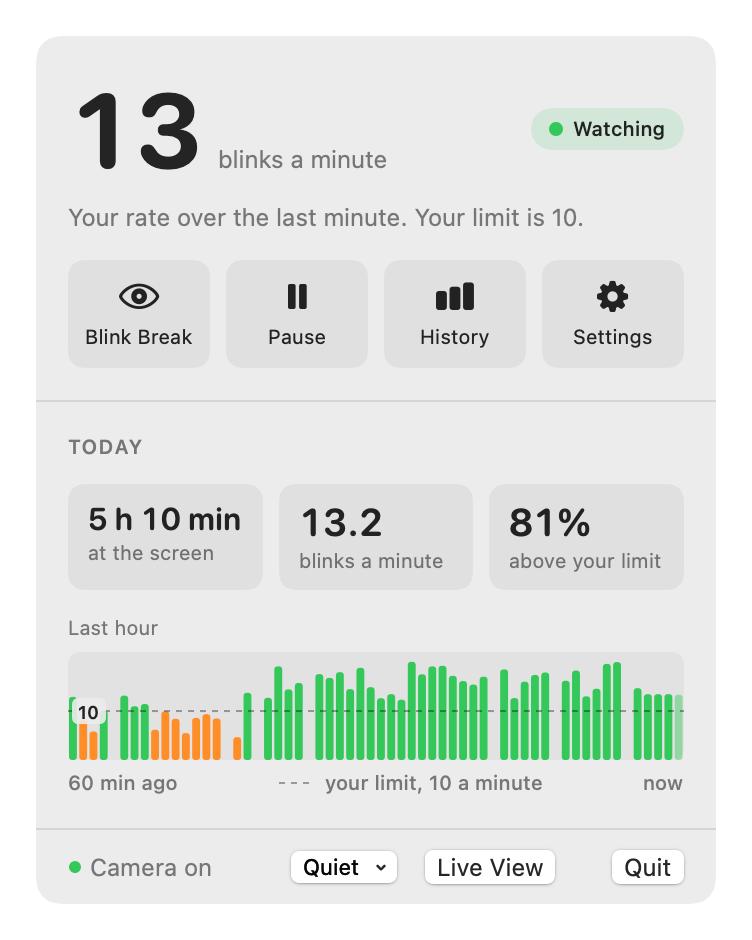
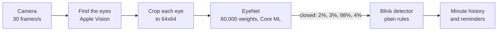
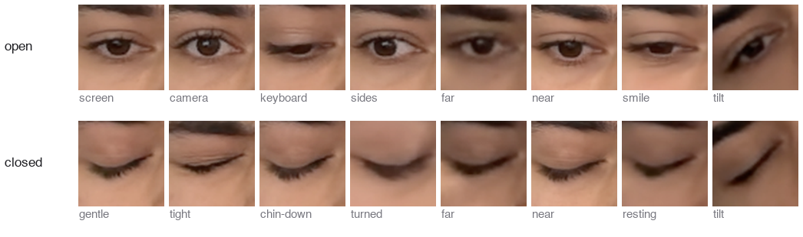

# Blink Monitor

A macOS menu-bar app that counts your blinks through the webcam, with a small neural
network **you train on your own eyes**. Everything runs on your Mac: no picture is stored
or sent anywhere.

<p align="center">
  
  &nbsp;&nbsp;
  
</p>

<sub>Screenshots are rendered by the app itself with made-up data (`make snapshots`).</sub>

## Why

People blink much less when they look at a screen, and for someone with dry eyes that is
exactly when it hurts. I wanted to know when I stop blinking, and I wanted to learn how a
small vision model is built end to end: collecting data, training, measuring honestly,
and shipping it inside a real app.

## What it does

- Shows your **blinks per minute** in the menu bar, with no Dock icon and no window.
- Keeps a **minute-by-minute history** (numbers only) and shows today, the last hour, the
  last seven days and the hours of the day when your rate drops.
- **Reminds you** when your rate stays low for three minutes; at most one reminder every
  five minutes, none for the time you were away, and a snooze.
- **Pause** switches the camera off for real. It also switches off when the screen sleeps
  or locks.

## How it works



1. **Find the eyes.** Apple's Vision framework places landmarks on the face. This part is not trained here.
2. **Crop.** Each eye becomes a 64x64 picture, so distance to the screen stops mattering.
3. **Classify.** A small convolutional network answers one question per eye: how sure is it that this eye is closed?
4. **Count.** A blink is a pattern in those answers: open, briefly closed, open again. A few rules turn the stream into blinks and reject look-downs and single-frame noise.

The same code cuts the eye pictures in the recorder and in the app, so the model is asked
about pictures made exactly like the ones it learned from.
[How it works](docs/HOW-IT-WORKS.md) goes through each step with figures.

<p align="center">
  
</p>

## Results

Measured on one person (me), on recordings made in one morning. Read them as "it works
for its author in his usual light", not as a general claim.

**Accuracy**

| What is measured | Result | How |
|---|---|---|
| Eye pictures answered right | 99.7% of 4,713 | each recording session judged by a model trained without it |
| Real blinks counted | 72 of 72 | 122 s of video with every blink marked by hand, each capture judged by a model that never saw it |
| False blinks | 1 in those 122 s | same |

The first version found 57 of those 72 blinks (79%). Getting to 72 took two changes that
the hand-marked blinks pointed to; [Lessons](docs/LESSONS.md) tells that story.

**Cost on a MacBook Pro (M5 Pro)**

| | First version | Now |
|---|---|---|
| Handing one eye picture to Core ML | 9.1 ms | 0.12 ms |
| Memory after running for a while | 591 MB after 11 min, 2.6 GB after 4 h (a leak) | 226 MB after 25 min |
| Processor, one core | about 60% | 36 to 47%, before the last optimisation |

The last optimisation (searching for the eyes every other frame) is in the code but its
effect is not in this table yet. The app logs its own cost once a minute to
`~/Library/Application Support/BlinkMonitor/performance.csv`.

## Privacy

- The camera picture is analysed in memory and dropped. Nothing is uploaded; the app makes no network connection.
- What is kept: one line per minute (time watched, blinks) in `~/Library/Application Support/BlinkMonitor/history.csv`.
- Pictures are written to disk only by the recorder and by the capture buttons of the diagnostics window, when you press them, to build your own training data.
- This repository contains **no recordings and no trained model**. Both are personal, and both are yours to make.

## Train it on your own eyes

You need an Apple Silicon Mac with macOS 14 or later, Apple's Command Line Tools
(`xcode-select --install`; full Xcode is not required) and [uv](https://docs.astral.sh/uv/).

```bash
git clone <this repository> && cd blink-monitor
```

| Step | Command | What happens |
|---|---|---|
| 1. Record | `make recorder` | A voice guides you through 16 poses, eyes open and closed. Two minutes a session; record five or six in different light. |
| 2. Train | `make train` | Trains the model (about a minute), reports its accuracy on sessions it never saw, converts it to Core ML and checks the conversion. |
| 3. Run | `make monitor` | Installs the menu-bar app in `~/Applications` and starts it. |
| 4. Measure (optional) | `make evaluate` | Counts blinks on captures you recorded and marked, with models that never saw them. |

After step 2, look at `training/out/review_suspicious.png`: it shows the pictures the
model disagrees with. Many will be blinks you made during an "eyes open" pose. Delete
them, run `python3 scripts/sync_manifests.py`, and train again.
[Development](docs/DEVELOPMENT.md) describes every command and file format.

## Project layout

```
Sources/BlinkCore       camera, eye finding and cropping, model, counting rules, history, file formats
Sources/BlinkUI         the SwiftUI views both apps share
Sources/BlinkRecorder   the app that records labelled eye pictures
Sources/BlinkMonitor    the menu-bar app
Tests/BlinkCoreTests    43 tests (Swift Testing)
training/               PyTorch training, Core ML conversion, labelling and evaluation tools, 15 tests
scripts/                app bundling, icon drawing, manifest repair
docs/                   how it works, lessons, development notes
```

## Limits and roadmap

- **One person, one morning.** The model has only seen its author, in daylight. Other light is untested.
- **Glasses.** A screen reflection covering the iris can read as a closed eye.
- **Looking down** at the keyboard looks like closed eyes from the camera's angle. A closure longer than 0.6 s is not counted as a blink, which covers most of it.
- **Incomplete blinks** (the lid comes down part of the way) matter for dry eyes and are not measured yet.
- **30 frames a second** is all the built-in camera gives. A very fast blink is closed on a single frame.

## Not a medical device

Blink Monitor is a personal project and a learning exercise. Its numbers are not a
diagnosis, and its default threshold of 10 blinks a minute is a starting point, not a
medical limit. If your eyes hurt, see an eye-care professional.

## Licence

[MIT](LICENSE).
