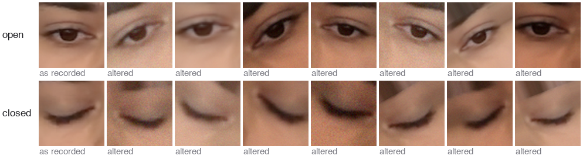

# How it works

Blink Monitor is four small problems chained together. Only one of them is machine
learning, and it was made as small as possible on purpose.

```
camera frame ──> 1. find the eyes ──> 2. crop to 64x64 ──> 3. open or closed? ──> 4. blink?
 1920x1080        Apple Vision          Core Image           EyeNet (trained)      plain rules
```

A blink lasts 0.1 to 0.4 s, which is 3 to 12 frames at 30 frames a second. Asking one
network to find a blink in a whole 1920x1080 video would need far more data than one
person can record. Asking "is this small eye picture open or closed?" needs a few thousand
pictures.

## 1. Recording the data

`make recorder` opens an app that labels pictures **by instruction**: a voice says what to
do, and every eye picture taken during the next three seconds gets that label. Nobody
clicks "open" or "closed" on thousands of pictures.

<p align="center"></p>

Three choices in the recording protocol (`Sources/BlinkRecorder/SessionScript.swift`):

- **Every pose is recorded open and closed.** A network learns whatever separates the two
  piles most easily. If "closed" always came with a lowered head, it would learn the head.
- **Some open poses look almost closed** (looking at the keyboard, a wide smile), so the
  only thing left that tells the piles apart is the eyelid.
- **One frame in three is kept.** Frames 33 ms apart are near copies.

Each session is one folder with a `manifest.csv` describing every picture (pose, eye,
head angle, crop size). Sessions matter for testing: see step 3.

## 2. Finding and cropping the eyes

`EyeLocator` asks Vision for the face's landmarks and computes one square per eye. The
square's side is 0.7 x the distance between the eyes: that distance stays stable when an
eye closes, while the eye's own outline collapses. `EyeCropper` resizes each square to
64x64.

When the head is turned far to one side, the far eye hides behind the nose and its
square lands on the cheek, so only the near eye is used.

This code lives in the shared library, `BlinkCore`. The recorder and the app call the
same functions, and a test checks that the app's fast path produces the very pixels the
training pictures were made of.

## 3. The model

`training/model.py` defines EyeNet: four convolution stages (64 -> 32 -> 16 -> 8 -> 4
pixels), an average over the picture, and one output. It has 60,465 weights and the file
is 250 KB.

**The preprocessing is inside the model.** It drops colour and gives every picture the
same brightness and contrast, so a dim room and daylight look alike. Because it is part of
the model, the app cannot do it differently by mistake.

**Augmentation.** Each time a picture is shown during training it is altered in ways that
do not change the answer: mirrored, rotated up to 35 degrees, zoomed, shifted, blurred.

<p align="center"></p>

**Testing by session.** Pictures of one session are near copies of each other, so testing
on random pictures would flatter the model. Instead, for each session in turn, a model is
trained on all the others and tested on that one. `make train` prints that table, with the
errors broken down by pose, and saves the wrongly answered pictures to one sheet.

**Conversion.** `training/convert.py` translates the model to Core ML, then runs the same
real pictures through both versions and fails if any answer differs by more than 0.001.

## 4. Real blinks

Eyes held open or closed are not blinks. In a real blink the lid is caught half-way and
blurred, and the first model missed them on the darker side of the face
([Lessons](LESSONS.md), number 2).

The app's Live View window can record every frame for 30 or 60 seconds, with the
model's answer for each. From those captures:

- `training/label_captures.py` labels frames with the rule "both eyes blink together":
  when the model is sure about one eye, the other is labelled too, provided Vision's eye
  outline agrees. Half-way frames are left unlabelled.
- `training/annotate.py` lays out every possible blink for a person to mark as blink,
  partial or none. That is the ground truth.
- `training/evaluate.py` replays each capture through a model trained without it, and
  reports blinks found, missed and falsely counted.

## 5. Counting

The model only says "closed: 2%, 3%, 98%, 99%, 4%" thirty times a second.
`BlinkDetector` finds blinks in that stream with four rules:

| Rule | Why |
|---|---|
| Closed above 60%, open again only below 40% | An answer hovering near 50% would otherwise count a blink at every crossing |
| Two closed frames in a row, or one frame at least 80% sure | A lone hesitant frame is a model mistake; a lone sure frame is a fast blink |
| At most 0.6 s | Longer is resting or looking down, reported as a long closure |
| Nothing counted across a gap | If the face was lost while the eyes were closed, nobody knows when they reopened |

The two eyes' answers are averaged before the rules are applied. The rules exist in Swift
(the app) and in Python (the evaluation); a test reads the numbers out of the Swift file
and fails if the two copies differ.

## 6. History and reminders

The rate shown is blinks per minute **of time your eyes were watched**: time away from the
screen does not lower it. One record per minute of the clock is appended to a CSV file.

A reminder needs evidence and restraint: a rate under your limit over the last three
minutes, with at least two of them watched, and never more than one reminder in five
minutes.

**The limit.** It starts at 6 blinks a minute. (The first version started at 10, and an
install that was already in use keeps that.) Once three hours have been watched over at
least two days, the app takes the median of those minutes as your reference and sets the
limit at 70% of it, never under the floor you chose. The reference is then kept: nothing
recomputes it. If you blink less as the weeks go by, the gap to the reference is reported
("23% less than your reference") and the limit stays where it was. A baseline that followed
you would lower the bar as you declined, and hide the very thing it is for. Measuring again
is a button in Settings, with a warning when the new value is lower.

**What studies report.** `PublishedRates` (in `BlinkCore/History`) is the one place a
number from a study lives: three ranges of blink rates, each with its source, and the
papers the Settings window lists. Healthy adults average 1.4 to 14.4 blinks a minute while
reading or at a screen, 8.0 to 21.0 looking straight ahead, and 10.5 to 32.5 in
conversation (Doughty 2001). The app shows these next to your own rate and limit, and
that is all they do:

- They are typical ranges, not ideal ones. No study gives a rate that is enough, so the
  words never say "ideal", "healthy" or "normal", and a test checks the sentences.
- They never set the limit. That stays your own reference and your floor.
- Nothing takes a colour because of them. Only your own limit turns a bar orange.

One number is derived from them: the floor a new install starts with. The eye surface is
covered while the next blink comes before the tear film breaks up. With a tear film that
holds 10 seconds and evenly spaced blinks, that is 6 a minute. It is arithmetic, not a
finding, and a starting point to adjust. The floor can be set from 1 to 20: some healthy
people make 0 to 2 complete blinks a minute at a screen (Freudenthaler 2003), and a limit
has to be able to follow them. When the limit ends up above your own usual rate, Settings
says so, because the app would say "Low" most of the time.

[What is a healthy blink rate?](BLINK-RATE.md) is the research: the studies, their limits
and how each was read.

## 7. Breaks and pauses

Three small pieces of logic, each a tested type in `BlinkCore/Monitoring`:

| Type | What it decides |
|---|---|
| `BlinkBreak` | The exercise counts every completed closure up to 3 s. Its blinks are slow on purpose and often last longer than the 0.6 s the counter accepts, so it has its own rule; the monitor's counting is not changed by it. |
| `PresenceTracker` | Time at the screen since the last break, where a break is 20 s with no face in view. The camera cannot see where you look, so the count also restarts once a nudge has been shown. |
| `PauseState` | A pause knows when it ends, ends by itself, and survives a relaunch. |

## 8. Keeping it cheap

The app runs all day, so its cost matters as much as its accuracy.

- Eye pictures reach Core ML as pixel buffers in the model's own format. The first version
  passed images and paid 9 ms per picture for it ([Lessons](LESSONS.md), number 3).
- The eyes are searched for every other frame; the frame in between reads the same squares.
  This saved 15% of a frame's cost, not the 40% expected: each search got slower. The README has the numbers.
- After 3 s without a face, one frame in six is analysed. (Both rules are one tested type, `FrameSchedule`.)
- With no window open, the interface is updated on change and once a second.
- The camera picture is only prepared while the Live View window shows it.
- The pipeline times its own stages and logs them every minute.
