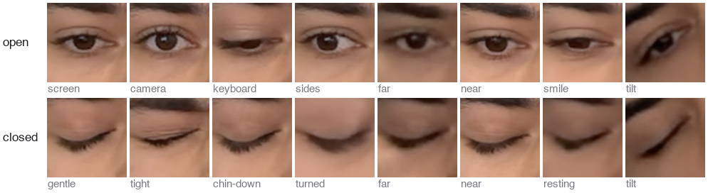

# How it works

Blink Monitor is four small problems chained together. Only one of them is machine
learning, and it was made as small as possible on purpose.

```
camera frame ──> 1. find the eyes ──> 2. crop to 64x64 ──> 3. open or closed? ──> 4. blink?
 1920x1080        Apple Vision          Core Image           EyeNet (trained)      plain rules
```

The network is trained on the eyes of the person who uses it, and the app does that
itself the first time it runs: it records, trains and tests. The sections below follow
that order, then the counting.

A blink lasts 0.1 to 0.4 s, which is 3 to 12 frames at 30 frames a second. Asking one
network to find a blink in a whole 1920x1080 video would need far more data than one
person can record. Asking "is this small eye picture open or closed?" needs a few thousand
pictures.

## 1. Recording the data

The app's setup labels pictures **by instruction**: a voice says what to do, and every eye
picture taken during the next three seconds gets that label. Nobody clicks "open" or
"closed" on thousands of pictures.

<p align="center"></p>

Three choices in the recording protocol (`Sources/BlinkCore/Recording/SessionScript.swift`):

- **Every pose is recorded open and closed.** A network learns whatever separates the two
  piles most easily. If "closed" always came with a lowered head, it would learn the head.
- **Some open poses look almost closed** (looking at the keyboard, a wide smile), so the
  only thing left that tells the piles apart is the eyelid.
- **One frame in three is kept.** Frames 33 ms apart are near copies.

Each session is one folder with a `manifest.csv` describing every picture (pose, eye,
head angle, crop size). Sessions matter for testing: see step 3.

**Before recording, the setup checks the camera**: a face in view for a second, each eye's
square at least as large as the 64 pixels the model reads, and enough light. The first is
required, since a recording of an empty chair teaches nothing. The other two are warnings.
The light limit is a starting value: every session this project was built on was brighter
than it, so nothing here shows where a model starts to fail.

**After recording, the session is checked**: pictures are only saved while a face is in
view, so a session that holds under 70% of what it can was partly recorded on an empty
chair. It is not kept, and the window says to record it again.

**Two sessions before the first training**, in different light. Measured on the author's
recordings (the table is in the README): trained on one session, the model found 55 to 70
of 72 real blinks depending on the session; on two, 60 to 72, and 69 on average.

## 2. Finding and cropping the eyes

`EyeLocator` asks Vision for the face's landmarks and computes one square per eye. The
square's side is 0.7 x the distance between the eyes: that distance stays stable when an
eye closes, while the eye's own outline collapses. `EyeCropper` resizes each square to
64x64.

When the head is turned far to one side, the far eye hides behind the nose and its
square lands on the cheek, so only the near eye is used.

This code lives in the shared library, `BlinkCore`. Recording and counting call the same
functions, and a test checks that the app's fast path produces the very pixels the
training pictures were made of.

## 3. The model

`training/model.py` defines EyeNet: four convolution stages (64 -> 32 -> 16 -> 8 -> 4
pixels), an average over the picture, and one output. It has 60,465 weights and the file
is 250 KB.

**The preprocessing is inside the model.** It drops colour and gives every picture the
same brightness and contrast, so a dim room and daylight look alike. Because it is part of
the model, the app cannot do it differently by mistake.

**Augmentation.** Each time a picture is shown during training it is altered in ways that
do not change the answer: mirrored, rotated up to 35 degrees, zoomed, shifted, blurred.

<p align="center"></p>

**Testing by session.** Pictures of one session are near copies of each other, so testing
on random pictures would flatter the model. Instead, for each session in turn, a model is
trained on all the others and tested on that one. `make train` prints that table, with the
errors broken down by pose, and saves the wrongly answered pictures to one sheet.

**Conversion.** `training/convert.py` translates the model to Core ML, then runs the same
real pictures through both versions and fails if any answer differs by more than 0.001.

### Training in the app

Everything above is the Python route (`make train`). It needs Python and PyTorch, 700 MB
of them, which nobody should have to install to count their blinks. So the app has the
same training written in Swift: `BlinkCore/Training`.

**The engine is MPSGraph**, Apple's framework for running and differentiating a network on
the Mac's graphics processor. PyTorch's own Mac mode is built on it, so this is the Python
route's engine without Python: the same network, the same alterations, the same optimiser
and schedule, 30 passes. Nothing is installed and nothing is added beside the app: with
the whole setup inside it, the app's program grew from 2.5 to 3.9 MB.

Three other ways were measured on the same pictures and splits before choosing
(commit `e2cb8a9` has their code; the README has the table):

| Way | Why not |
|---|---|
| Core ML's own on-device training | It can only train convolutions and fully-connected layers. Batch normalisation, dropout and the learning-rate schedule are lost: 211 of 216 blinks found, where MPSGraph and Python found all 216 |
| Create ML's image classifier | It counts well (71 of 72) but needs 2.8 ms to read one eye, against 0.1 ms. Too costly for an app that runs all day |
| MLX Swift | Its own instructions say the command line cannot build its graphics code without Xcode, which this project does not require |

**It runs in a helper process.** The app starts itself a second time with `--train`; that
copy only trains, and prints its progress line by line. The training happens inside
Apple's graphics frameworks, and when they fail they end the process they are in. In a
helper that is a training to start again. In the app it would be the app gone, in the
middle of its setup.

**The time left is measured, not guessed.** The window says nothing about time during the
first pass, which includes warming up. From the second pass on, it knows what a pass costs
on this Mac. On an M5 Pro the helper took 22 seconds for four sessions (3,721 pictures),
reading and checking included, and held about 650 MB while it ran. How long an older Mac
takes is not known.

**The model exists in two forms, and they are compared.** The trainer learns on the
graphics processor, with batch normalisation. What runs afterwards is the network written
out in Swift (`EyeNetwork`, four matrix products per eye on the processor), from weights
with the normalisation folded in. Core ML is not used for these models: it has no public
way to put new weights into a model. A mistake in that translation would not crash; the
model would simply answer worse. So after every training, every picture is given to both
forms, and a model whose two forms differ by more than 0.001 is not installed. This is
`convert.py`'s check, done on the user's Mac. A test also gives `EyeNetwork` the Python
model's weights and holds it to Python's answers on real pictures.

**A new model never overwrites the one in use.** The training writes to `model.new`. Only
a model that passed its check is moved into place, and the one it replaces is kept once,
so that a session that made things worse can be undone.

## 4. Real blinks

Eyes held open or closed are not blinks. In a real blink the lid is caught half-way and
blurred, and the first model missed them on the darker side of the face
([Lessons](LESSONS.md), number 2).

The app's Live View window can record every frame for 30 or 60 seconds, with the
model's answer for each. From those captures:

- `training/label_captures.py` labels frames with the rule "both eyes blink together":
  when the model is sure about one eye, the other is labelled too, provided Vision's eye
  outline agrees. Half-way frames are left unlabelled.
- `training/annotate.py` lays out every possible blink for a person to mark as blink,
  partial or none. That is the ground truth.
- `training/evaluate.py` replays each capture through a model trained without it, and
  reports blinks found, missed and falsely counted.

**The setup's own test** is the short form of that measurement, for a user who has no
marked captures: ten ticks a second and a half apart, a blink at each, counted by the
model that was just trained through the very code that will count all day. A blink
answers the last tick played before it. Eight of ten is a pass, which leaves room for a
tick the person missed. Under eight, the app says the number and leaves the choice: one
more session where you sit now, the test again, or the model as it is.

The frames of real blinks that `label_captures.py` produces are only used by the Python
route so far. The app's own trainer learns from sessions alone.

## 5. Counting

The model only says "closed: 2%, 3%, 98%, 99%, 4%" thirty times a second.
`BlinkDetector` finds blinks in that stream with four rules:

| Rule | Why |
|---|---|
| Closed above 60%, open again only below 40% | An answer hovering near 50% would otherwise count a blink at every crossing |
| Two closed frames in a row, or one frame at least 80% sure | A lone hesitant frame is a model mistake; a lone sure frame is a fast blink |
| At most 0.6 s | Longer is resting or looking down, reported as a long closure |
| Nothing counted across a gap | If the face was lost while the eyes were closed, nobody knows when they reopened |

The two eyes' answers are averaged before the rules are applied. The rules exist in Swift
(the app) and in Python (the evaluation); a test reads the numbers out of the Swift file
and fails if the two copies differ.

## 6. History and reminders

The rate shown is blinks per minute **of time your eyes were watched**: time away from the
screen does not lower it. One record per minute of the clock is appended to a CSV file.

A reminder needs evidence and restraint: a rate under your limit over the last three
minutes, with at least two of them watched, and never more than one reminder in five
minutes.

**The limit.** It starts at 10 blinks a minute. Once three hours have been watched over at
least two days, the app takes the median of those minutes as your reference and sets the
limit at 70% of it, never under the floor you chose. The reference is then kept: nothing
recomputes it. If you blink less as the weeks go by, the gap to the reference is reported
("23% less than your reference") and the limit stays where it was. A baseline that followed
you would lower the bar as you declined, and hide the very thing it is for. Measuring again
is a button in Settings, with a warning when the new value is lower.

## 7. Breaks and pauses

Three small pieces of logic, each a tested type in `BlinkCore/Monitoring`:

| Type | What it decides |
|---|---|
| `BlinkBreak` | The exercise counts every completed closure up to 3 s. Its blinks are slow on purpose and often last longer than the 0.6 s the counter accepts, so it has its own rule; the monitor's counting is not changed by it. |
| `PresenceTracker` | Time at the screen since the last break, where a break is 20 s with no face in view. The camera cannot see where you look, so the count also restarts once a nudge has been shown. |
| `PauseState` | A pause knows when it ends, ends by itself, and survives a relaunch. |

## 8. Keeping it cheap

The app runs all day, so its cost matters as much as its accuracy.

- Eye pictures reach the model as pixel buffers in its own format. The first version
  passed images and paid 9 ms per picture for it ([Lessons](LESSONS.md), number 3).
- A model trained in the app costs 0.24 ms per eye picture, a Core ML one 0.10 ms. Both
  are small beside the 12 ms a frame takes.
- The eyes are searched for every other frame; the frame in between reads the same squares.
  This saved 15% of a frame's cost, not the 40% expected: each search got slower. The README has the numbers.
- After 3 s without a face, one frame in six is analysed. (Both rules are one tested type, `FrameSchedule`.)
- With no window open, the interface is updated on change and once a second.
- The camera picture is only prepared while the Live View window shows it.
- The pipeline times its own stages and logs them every minute.
