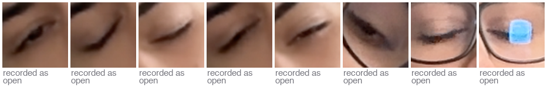
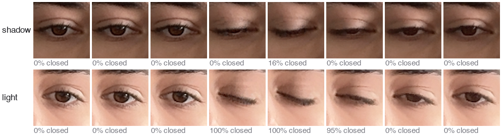

# Eight things this project taught me

Each of these looked fine until something was measured or looked at. The numbers are from
my own recordings: one person, one morning.

## 1. The labels were wrong before the model was

A recording labels pictures by instruction: a voice says "eyes open", and everything
filmed during the next three seconds is saved as "open". But people blink, including
during an "eyes open" pose.

After the first training, I looked at the pictures the model got "wrong". Of the 30,
12 were these: closed eyes saved as open. The model was right and the label was wrong.

Removing those 12 pictures (of 3,733) changed more than 12 answers:

| | Before | After |
|---|---|---|
| Pictures answered right, on sessions never seen | 99.20% | 99.57% |
| Closed eyes called open | 2 | 0 |
| Open eyes called closed | 28 | 16 |

**What I keep from it:** when a model disagrees with a label, look at the picture before
blaming the model. `training/train.py` writes those pictures to one sheet for that reason.

## 2. The eye in the shadow

The model scored 99.6% on pictures, and then missed about one fast blink in two in real use.

To see why, I recorded every frame of 20 cued blinks and laid one out, 33 ms per frame.
Under each picture is the model's answer:

The model saw the well-lit eye close and did not see the other one, in the same frame.
The app averaged the two eyes, 100% and 16% make 58%, and the blink was rejected.

The training pictures were eyes held still. A real blink on the darker side of the face is
dim and blurred by the lid's own speed, and nothing like it was in the training set.

Labelling 3,600 frames by hand was out of the question, so `training/label_captures.py`
uses a rule: **both eyes blink together**. When the model is sure one eye is closed, the
other eye is closed in that frame too, whatever the model says about it. That gives a
correct label exactly where the model is wrong. A second witness has to agree: the eye
outline drawn by Apple's Vision, which does not depend on the model, must be nearly flat.

Result on the two cued recordings, each judged by a model trained without it: 13 and 19
blinks of 20 counted before, 20 and 20 after.

**What I keep from it:** a model is only as good as the resemblance between its training
pictures and what it meets in use. The fix was not a bigger model; it was 350 pictures of
the right kind.

## 3. One call cost 87% of the processor time

The first menu-bar build used about 60% of a processor core and grew to 2.6 GB of memory
in four hours. I expected the face-finding step to be the cost.

A 4-second profile of the running app said otherwise: 968 of the 1,003 samples of the
frame pipeline were inside one call, `MLFeatureValue(cgImage:)`, the line that hands an
eye picture to the model. For each picture, Core ML was building a new Core Image context,
reloading Metal libraries and hashing them, 60 times a second.

Handing the model a pixel buffer already in its own format (64x64, BGRA) removes all of it:

| | Before | After |
|---|---|---|
| Handing one eye picture to Core ML | 9.1 ms | 0.12 ms |
| Memory | 591 MB after 11 min | 226 MB after 25 min |
| Processor, one core | about 60% | 36 to 47% |

A test checks that the new path gives the same pixels as the one the training pictures
were made with (difference: 0 of 255), and another that the Swift app gives the answers
Python computed for the same pictures.

**What I keep from it:** profile first. My guess was wrong, and a guess would have had me
optimising the wrong stage. The app now times its own stages and logs them every minute.

## 4. "99.7% of pictures" is not "my blinks are counted"

Every number above the last one is about pictures. What I wanted to know was whether
blinks were counted, and nothing measured that.

So `training/annotate.py` finds every moment where a blink may have happened and lays it
out frame by frame, and I marked each of the 88 candidates by eye: 72 blinks, 2 partial,
14 false alarms, in 122 s of video. `training/evaluate.py` then replays each recording
through a model that never saw it and compares counts with marks.

| | Blinks found (of 72) | False blinks |
|---|---|---|
| As the app counted that day | 57 (79%) | 0 |
| Retrained model, same counting rules | 67 (93%) | 0 to 1 |
| Counting a single closed frame when the model is at least 80% sure | 72 (100%) | 1 |

The remaining misses were fast blinks closed on a single 33 ms frame, which my own rule
("two closed frames in a row") was throwing away.

The same measurement also told me what not to do. Training with motion blur and low-light
noise sounded like the obvious remedy for lesson 2. Measured, it found fewer blinks and
counted more false ones, so it is in the code, switched off, with its numbers.

**What I keep from it:** measure the thing you care about, and let that measurement veto
ideas that only sound right. One caution about these figures: the rule was chosen on the
same three recordings it is reported on, so the 100% is the best case, not a promise.

## 5. An optimisation that did not pay

Finding the eyes with Apple Vision was most of the cost of a frame. The eyes do
not move far in 33 ms, so the plan was simple: search every other frame, and on the frame
in between read the same squares again. Half the searches, so close to 40% less work.

The app writes its own cost to a file once a minute, so the before and after are its own
numbers:

| | Finding the eyes, per frame | Whole frame |
|---|---|---|
| Searching every frame | about 12 ms | about 14.5 ms |
| Searching every other frame | about 9 ms | about 12.3 ms |

15% less, not 40%. A search that runs half as often takes half as long again (about 18 ms
instead of 12). I do not know why yet. The app still uses about 37% of one core while it
watches, which is too much for something that runs all day.

**What I keep from it:** the first README said the optimisation was "in the code, effect
not measured yet". Had the log not existed, that sentence would have stayed, and I would
have gone on believing a number I had only calculated.

## 6. A baseline that would have hidden the problem

A fixed limit ("under 10 blinks a minute is too little") suits few people, so the next
feature was a personal one: learn the usual rate, warn at 70% of it. The first design was
a rolling average of recent weeks.

The objection came before any code was written: if someone blinks a little less every month, that
average goes down with them, the limit goes down with it, and the app never says a word.
It would adapt to precisely the decline it exists to catch.

So the reference is measured once and kept. A decline is shown against it ("23% less than
your reference") instead of being absorbed by it, measuring again is a button with a
warning when the new value is lower, and the limit cannot go under a floor chosen by hand.
A test feeds it four weeks of steady decline and checks that nothing has moved.

**What I keep from it:** a measure that adapts to its subject stops measuring it. Ask of
any "personalised" threshold what happens when the person slowly gets worse.

## 7. The chart that showed the hour before launch

The panel's last-hour chart looked wrong in a screenshot: a few bars on the far left,
nothing else. The explanation came easily: those are old minutes, the chart needs a time
axis. An axis was added. The chart was still wrong.

The cause was one line. Every window had `var now = Date()`, so that the screenshots could
pass a fixed date. A view is created once and kept, so that date was the moment the app
was launched. Every minute recorded afterwards was "in the future" and never drawn; after
midnight, "today" was still yesterday. All 80 tests passed, because each test passed its
own date, and the screenshots looked right, because they passed one too.

The fix is a type that cannot hold a stale date: a window asks a `Moment` for the present
each time it draws, and a test fails if a view stores `Date()` again. The app had no
tests of its own, only its rules had; it has them now, and it can run on made-up eyes so
that its windows can be exercised without a face.

**What I keep from it:** a default value written to make something testable can be the
bug, and the tests built on it will never show it. And the first plausible explanation
of a symptom is a hypothesis: the chart was "explained" and decorated before anyone
checked what it was drawing.

## 8. The test that took the Mac down

Training moved into the app, written in Swift on Apple's MPSGraph. Twice in about 280
trainings, the framework ended the program with an assertion of its own, deep in the way
it stores weights between steps ("variables"). The remedy looked clean: keep the weights
outside the graph, hand them in at each step and take the new ones back, as PyTorch does.

To know whether the remedy worked, a "soak" test was written: both versions, training in
a loop as fast as they could, side by side, for 45 minutes, while a third program ran the
full comparison with Python. It was started in the background and left alone.

Three minutes later the Mac's screen went black and it had to be forced off.

What the reports say: the window server tried to create a graphics surface, was refused,
aborted, restarted and aborted again, twelve times in two minutes. One minute earlier, the
comparison had printed a line that said the same thing in other words: 11,441 of 11,833
pictures "could not be read", because macOS was already refusing graphics memory to it.

The cause was in the remedy itself. The new version receives fifty arrays from the
graphics processor at every step. Such objects are freed when a "pool" is emptied, and a
program that only loops never empties one, so every step's arrays stayed.

That was first reasoned from the reports, then measured, this time with the owner's
agreement, one program at a time, under a guard that reads the memory every three seconds
and stops the program above a limit:

| One training of 4,450 pictures, 20 s | Memory during the training |
|---|---|
| No pool emptied at each step | 880 MB rising to 2,134 MB in 15 s: about 65 MB a second |
| A pool emptied at each step | 1,131 to 1,137 MB: flat |

Three such programs had been running at once, two of them with no end.

Three mistakes, in the order they were made:

- **A new design went straight into a stress test.** It had run once, for twenty seconds.
  Nobody had watched its memory.
- **The stress test had no limit.** No ceiling on memory, no "stop if the machine
  struggles", three heavy jobs at once, on the Mac someone was working on.
- **The warning was read as a bug to fix.** "Pictures could not be read" was treated as a
  fragile loader (it was one, and it was fixed) instead of as a machine in distress, and
  the comparison was started again on top of it.

What changed: every step now empties its pool, the loader no longer asks for graphics
memory to read a file, a training refuses to start when many pictures are missing, the
tests that train never run two at a time, and the soak test is gone. Whether keeping the
weights outside the graph ends the original assertion is not known: the measurement that
would say so is the one that was stopped.

**What I keep from it:** a test that pushes a machine to find a rare failure is itself a
dangerous program. It gets a memory ceiling, a time limit, one job at a time, and the
owner's agreement before it runs, or it does not run. And a strange error from a healthy
program is sometimes the machine speaking.
